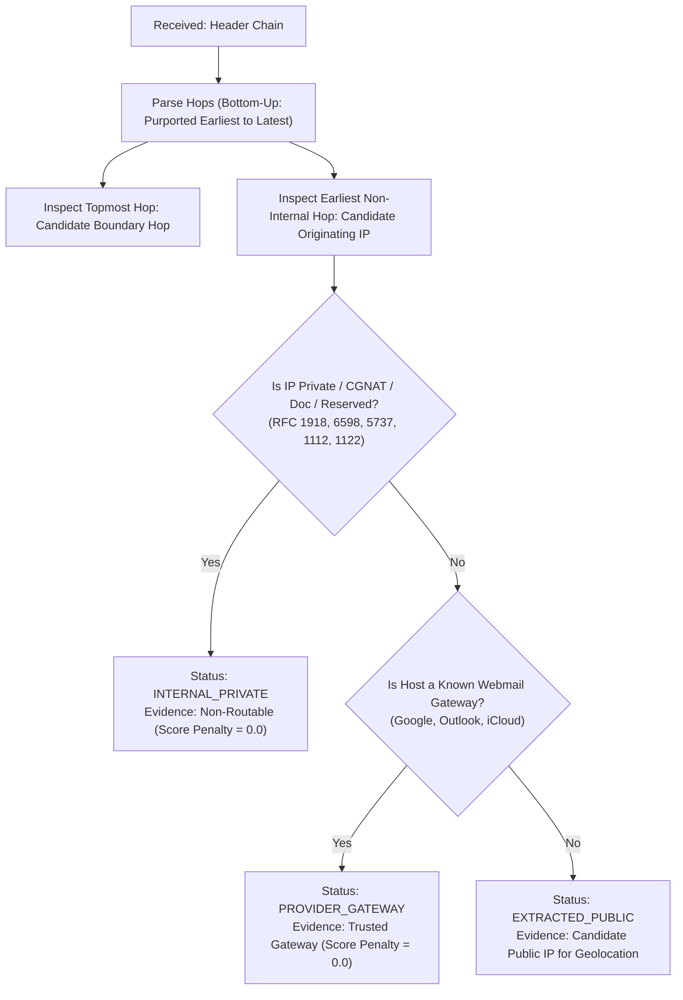

# Proposed System Architecture: AI-Powered Email Threat Detection, Geolocation and Forensic Intelligence Platform

---

## 1. Executive Summary & Design Principles

The **AI-Powered Email Threat Detection, Geolocation and Forensic Intelligence Platform (PhishIntel)** unifies the rigorous transport authentication from **Paper 1 (Diallo & Thapar, 2025)** with the deep contextual natural language processing and threat intelligence from **Paper 2 (Noorain et al., 2026)**.

### Core Architectural Principles
1. **Strict Free-Only & Open-Source (Zero Cost):** Every single required component, library, model, and dataset operates under permissive open-source licenses. **Zero paid APIs, zero subscriptions, zero paid billing profiles, and zero commercial licenses.** The platform runs completely without entering credit card or billing details.
2. **Distinction: Free Software vs. Free Online Services:**
   - **Free & Open-Source Software (FOSS):** Python, PyTorch, Hugging Face Transformers, FastAPI, React, Leaflet, ReportLab, and `pyspf`/`dkimpy`. These run locally on your machine with **unlimited usage and zero external dependencies**.
   - **Free Online Services with Restrictions:** OpenStreetMap tile servers (governed by OSM Tile Usage Policy: requires custom User-Agent, browser caching, and no bulk scraping), public DNS resolvers, and optional public community APIs (like AbuseIPDB free tier with 1,000 checks/day). **None of these online services are mandatory.**
3. **Offline & Air-Gap Resilience:** The platform is engineered to function reliably even when external network connectivity is disconnected. Ingestion, parsing, 6-state auth, lexical URL analysis, static attachment inspection, transformer NLP, and IP geolocation can all run 100% locally.
4. **Strict Non-Execution Security Policy:** Suspicious attachments, embedded scripts (VBA, JavaScript), and extracted URLs are **NEVER executed, detonated, or requested over the network**. All evaluations are strictly passive and static (magic bytes, structural syntax, lexical tokens, and text analysis).
5. **Ambiguous & Unavailable Originating IP Handling:** Many legitimate email providers (e.g., Gmail, Outlook webmail) deliberately strip end-user client IPs from `Received:` headers to protect privacy, leaving only corporate gateway IPs. Others use internal RFC 1918 subnets. The platform explicitly classifies IP evidence into four states:
   - `EXTRACTED_PUBLIC`: Valid public IP isolated from client hop.
   - `PROVIDER_GATEWAY`: Originating hop belongs to a major mail provider; client IP suppressed.
   - `INTERNAL_PRIVATE`: Client IP is within RFC 1918 / loopback ranges.
   - `UNAVAILABLE`: Headers missing or unparseable.
   *Missing or provider-masked client IPs are evaluated neutrally, never as proof of an attack.*
6. **Evidence-Based Forensic Non-Discard:** Emails with failed or missing authentication are **never automatically discarded**. Every email is preserved, decomposed into forensic artifacts, and audited across all dimensions.
7. **Context-Aware, Non-Punitive Authentication:** Missing SPF, DKIM, or DMARC records (`NONE` or `NOT CONFIGURED`) are evaluated objectively as lack of evidence, **never as proof of malicious intent**.
8. **Anti-Double-Counting Risk Engine:** Risk signals are strictly orthogonal. An anomaly observed in the transport headers is evaluated under transport authentication without double-penalizing the IP score.

---

## 2. Technology Inventory & Service Classification

| Architecture Layer | Component | Selected Technology | Category | Usage Terms & Offline Fallback |
| :--- | :--- | :--- | :--- | :--- |
| **Ingestion** | RFC 5322 MIME Parser | Python `email`, `email.policy` | **Free Software (PSF)** | 100% local, built-in, zero network calls. |
| **Transport Auth** | SPF DNS Verification | `pyspf`, `dnspython` | **Free Software (PSF/ISC)** | Free DNS queries with local TTL caching. If offline: `TEMPORARY ERROR`. |
| **Transport Auth** | DKIM Signature Verifier | `dkimpy` | **Free Software (BSD)** | Free public-key validation via DNS. If offline: `NOT VERIFIABLE`. |
| **Transport Auth** | DMARC Policy Engine | Custom Python evaluator | **Free Software (Custom)** | Evaluates alignment and DNS policy locally. |
| **IP Geolocation** | Geolocation & ASN | **DB-IP Lite** / **MaxMind GeoLite2** | **Free Data (CC-BY 4.0 / Free)** | **100% Offline `.mmdb` database file.** Reads from disk with zero network queries. |
| **Map Rendering** | Geolocation Map UI | **Leaflet** + **OpenStreetMap Tiles** | **Free Software + Free Web Service** | Complies with OSM Tile Policy (identifying User-Agent, cached). Includes **offline SVG world map fallback**. |
| **Network Intel** | IP Threat Scoring | Local Classifier + *Optional* AbuseIPDB | **Free Software + Optional Free Service** | **Strictly optional integration.** Platform works 100% without an API key; defaults to neutral ($S_{ip}=0.0$). |
| **URL Forensics** | Lexical & Syntax Extractor | Python standard regex, `urllib` | **Free Software (PSF)** | 100% local mathematical/lexical scoring. **Never performs HTTP GET on links.** |
| **URL Forensics** | Blacklist Matching | **PhishTank Free Community Feed** | **Free Community Data** | Cached local CSV/SQLite file. 100% offline. |
| **Attachment** | Magic Byte Detection | Native byte signatures / `filetype` | **Free Software (MIT)** | 100% local binary header inspection. **Never executes files.** |
| **Attachment** | Static Macro & Script Scan | `oletools` | **Free Software (BSD)** | 100% local static byte inspection. **Zero code execution.** |
| **HTML Sanitization** | XSS Defense & Sanitization | Python `html.parser` (Pure Python) | **Free Software (PSF)** | 100% local standard library with strict tag/attr allowlists, remote tracking image neutralization, and zero native DLL dependencies. Falls back to `html.escape`. |
| **NLP Semantics** | Transformer Model | `microsoft/deberta-v3-small` / `distilbert-base-uncased` | **Free Software (Apache 2.0)** | **Runs locally on RTX 3050 GPU (with INT8 CPU fallback).** Zero cloud LLM API calls. |
| **Backend** | REST API Engine | FastAPI + Uvicorn | **Free Software (MIT/BSD)** | Free, lightweight asynchronous Python server. |
| **Frontend** | Forensic Dashboard | React 18 + Vite + Tailwind CSS | **Free Software (MIT)** | Free, local browser interface. |
| **Reporting** | PDF Forensic Dossier | ReportLab Community Edition | **Free Software (BSD)** | Free open-source PDF generator (`pip install reportlab`). |
| **Reporting** | JSON Export | Python `json` standard library | **Free Software (PSF)** | 100% built-in, local serialization. |

---

## 3. Transformer Model Architecture & Hardware Profile (RTX 3050 6GB + 16GB RAM)

### 3.1 Research Model Alignment
- **Paper 2 Findings:** Evaluated BERT, RoBERTa, and DeBERTa. DeBERTa achieved superior performance due to its disentangled attention mechanism.
- **Proposed Local Checkpoints:**
  1. **Primary Model:** `microsoft/deberta-v3-small` (44M backbone parameters, 141M total with 128k vocabulary).
  2. **Alternative Lightweight Model:** `distilbert-base-uncased` (66M parameters).
- **Zero Cloud Dependence:** Both models are free open-source architectures downloaded from Hugging Face and cached locally. No calls to OpenAI, Gemini, or Grok.

### 3.2 Hardware-Aware Execution & Verification Protocol
- **No Assumed Benchmarks:** While theoretical calculations indicate `deberta-v3-small` should consume ~1.1 GB VRAM and execute in ~30–50 ms, **we will not assume these figures**. We will empirically measure and report actual VRAM consumption and inference latency on your laptop's **RTX 3050 6GB GPU**.
- **Dual Execution Pipelines:**
  1. **GPU Pipeline (CUDA / FP16):** Uses `torch.cuda.amp.autocast()` for hardware acceleration on the RTX 3050.
  2. **CPU Fallback Pipeline (Dynamic INT8 Quantization):** Implemented via `torch.quantization.quantize_dynamic(model, {torch.nn.Linear}, dtype=torch.qint8)`. Tested and verified independently on system RAM (16GB) to guarantee high performance when CUDA is unavailable.

---

## 4. Received Header Forensic Analysis & IP Evidence Classification

### 4.1 Forensic Principles of Received: Header Analysis
1. **Candidate Boundary Hop:** In an arbitrary uploaded `.eml` file, the topmost `Received:` header represents only a **candidate boundary hop**. It cannot automatically be considered tamper-resistant because an attacker constructing an offline `.eml` file can author arbitrary synthetic headers.
2. **Potentially Sender-Injected Hops:** Lower `Received:` headers are treated as potentially sender-injected or untrusted intermediate hops.
3. **Independent Trust Establishment:** A boundary hop is ONLY classified as trusted (`is_boundary_trusted = True`) when the receiving infrastructure is independently verified via authenticated ingestion context (out-of-band gateway/milter metadata). An uploaded `.eml` file cannot establish its own trust; matching a `by_host` domain alone does NOT establish authenticity.
4. **Timestamp Anomalies vs. Authenticity:** Timestamp checks reveal internal chronological delay anomalies (such as anachronisms or backwards time jumps), but **do not prove header authenticity**.
5. **Evidence vs. Verification:** The platform maintains a strict distinction between **extracted candidate IP evidence** (what the header chain claims) and **verified boundary IP evidence** (independently authenticated ingestion).

### 4.2 Comprehensive Discrete RFC IP Classification
The platform evaluates all extracted IP candidates against discrete RFC standards using Python 3.13:
- **`INTERNAL_PRIVATE`:** RFC 1918 Private ranges (`10.0.0.0/8`, `172.16.0.0/12`, `192.168.0.0/16`) and IPv6 Unique Local (`fc00::/7`).
- **`LOOPBACK`:** RFC 1122 and RFC 4291 Loopback ranges (`127.0.0.0/8`, `::1`).
- **`LINK_LOCAL`:** RFC 3927 and RFC 4291 Link-Local autoconfiguration ranges (`169.254.0.0/16`, `fe80::/10`).
- **`CGNAT`:** RFC 6598 Carrier-Grade NAT (`100.64.0.0/10`).
- **`DOCUMENTATION`:** RFC 5737 Test & Documentation (`192.0.2.0/24` TEST-NET-1, `198.51.100.0/24` TEST-NET-2, `203.0.113.0/24` TEST-NET-3) and RFC 3849 (`2001:db8::/32`). Never treated as globally routable public IPs.
- **`RESERVED_MULTICAST`:** RFC 1112 Class E Reserved (`240.0.0.0/4`), RFC 5771 Multicast (`224.0.0.0/4`, `ff00::/8`), and Broadcast (`255.255.255.255`).
- **`PROVIDER_GATEWAY`:** Major webmail providers (Google, Microsoft 365, iCloud) where client IP is suppressed for privacy.
- **`EXTRACTED_PUBLIC`:** Genuinely globally routable public unicast IPs (`is_global == True`).
- **`UNAVAILABLE`:** Headers absent, malformed, or unparseable.



---

## 5. Evidence-Based 6-State Email Authentication

Authentication is evaluated objectively across six discrete states:

| State | Definition | Security Assessment | Risk Penalty |
| :--- | :--- | :--- | :---: |
| **`PASS`** | Cryptographic signature or SPF IP match confirmed. | Sender domain verified. | **$0.0$** |
| **`FAIL`** | Explicit hash mismatch or SPF `-all` rejection. | High probability of domain spoofing or message tampering. | **Elevated** |
| **`NONE`** | Header omitted entirely (e.g., unsigned email). | Neutral evidence. Common in personal or legacy mail. | **$0.0$** |
| **`NOT CONFIGURED`** | Domain has no SPF or DMARC record published in DNS. | Neutral evidence. Common among small businesses. | **$0.05$** |
| **`NOT VERIFIABLE`** | Public key revoked, missing from DNS, or malformed. | Flagged for manual analyst inspection. | **$0.0$** |
| **`TEMPORARY ERROR`** | DNS lookup timed out or network interface disconnected. | Non-punitive indeterminate state. | **$0.0$** |

---

## 6. Explainable Risk Engine & Anti-Double-Counting Rules

### 6.1 Formula
$$Score_{Final} = w_{nlp} \cdot S_{nlp} + w_{auth} \cdot S_{auth} + w_{url} \cdot S_{url} + w_{att} \cdot S_{att} + w_{ip} \cdot S_{ip}$$
Where $\sum w_i = 1.0$.

### 6.2 Default Factor Weights & Orthogonal Scopes

| Factor | Weight | Scope | Anti-Double-Counting Safeguard |
| :--- | :---: | :--- | :--- |
| **$S_{nlp}$ (Transformer NLP)** | **0.30** | Analyzes text semantics for urgency, coercion, and impersonation. | Evaluates text only; blind to headers, URLs, and IPs. |
| **$S_{auth}$ (Header & Auth)** | **0.25** | Evaluates 6-state SPF/DKIM/DMARC, `Reply-To` mismatch, display name spoofing. | Evaluates headers only; does not score IP reputation. |
| **$S_{url}$ (URL Forensics)** | **0.20** | Evaluates lexical features, anchor mismatches, and local PhishTank matches. | Purely lexical and static; **never executes HTTP requests**. |
| **$S_{att}$ (Attachment Static)** | **0.15** | Magic byte mismatches, double extensions, static macro triggers. | Purely static; **never executes files or macros**. Defaults to $0.0$ if no attachments. |
| **$S_{ip}$ (IP Geolocation & Intel)** | **0.10** | Geolocation anomalies and local/optional IP reputation. | Defaults to $0.0$ if IP is internal, provider-gateway, or unavailable. |

*Weights and thresholds are stored in `config.yaml` for dynamic configuration.*

---

## 7. Leaflet Map Visualization & OpenStreetMap Compliance

1. **Tile Server Policy Compliance:** Leaflet queries OpenStreetMap tile servers with an application-specific `User-Agent` header, respects caching headers, and limits zoom levels to avoid overloading community infrastructure.
2. **Offline Fallback:** If internet access is disconnected or tile requests fail, the map component displays the extracted coordinates and country/city information over an embedded **offline SVG schematic world map**.

---

## 8. Clear Scope Demarcation

```
┌──────────────────────────────────────────────┬──────────────────────────────────────────────┐
│       INITIAL WORKING VERSION (Priority)     │       FUTURE ENHANCEMENTS (Deferred)         │
├──────────────────────────────────────────────┼──────────────────────────────────────────────┤
│ • RFC 5322 email parsing (.eml / .msg)       │ • Quishing (QR code phishing computer vision)│
│ • Header hop analysis & IP ambiguity logic   │ • Automated STIX 2.1 / TAXII threat export   │
│ • Evidence-based 6-state SPF, DKIM, DMARC    │ • Dynamic attachment sandboxing & detonation │
│ • Static & lexical URL forensic engine       │ • YARA rule signature integration            │
│ • Static attachment extension & macro scan   │ • Real-time interactive AI reply assistant   │
│ • Transformer NLP (GPU FP16 + CPU INT8)      │ • Multilingual LLM fine-tuning               │
│ • GeoLite2 / DB-IP offline geolocation       │ • Native Electron desktop wrapper            │
│ • Leaflet + OSM (with offline SVG fallback)  │                                              │
│ • Explainable risk scoring (config.yaml)     │                                              │
│ • FastAPI backend & React dashboard          │                                              │
│ • Automated PDF (ReportLab) & JSON export    │                                              │
└──────────────────────────────────────────────┴──────────────────────────────────────────────┘
```
